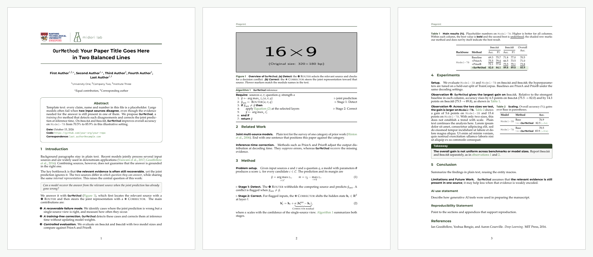

# Midori Preprint

Midori Lab 的 arXiv 预印本 LaTeX 模板，以及一个把已有论文转换成这个模板的 Claude skill。

*An arXiv preprint LaTeX template from Midori Lab (NTU), plus a Claude skill that converts an existing LaTeX paper (NeurIPS, ICLR, ICML, ACL, CVPR, COLM, custom classes…) to the template. It changes only the template and layout, never the paper's text or the authors' own formatting.*



## 仓库内容

| 目录 | 内容 |
|---|---|
| [`template/`](template) | LaTeX 模板：`preprint.sty`、参考文献样式、logo、完整示例 `main.tex` 和编译好的预览 PDF。说明见 [`template/README.md`](template/README.md) |
| [`skill/midori-preprint/`](skill/midori-preprint) | Claude skill：把已有的 LaTeX 论文转换成这个模板 |
| [`tools/`](tools) | 维护脚本：把模板文件同步到 skill |
| `dist/midori-preprint.skill` | 打包好的 skill 安装包 |

## 模板特点

- Palatino 正文 + Montserrat 无衬线标题，5.5in 单栏（`[wide]` 为 6.5in）
- 首页：NTU + Midori Lab logo，上粗下细两条深绿线夹住的标题，逐个书写的作者和单位，带 Date / Code / Correspondence 的圆角摘要框
- Midori 绿色配色（`#2D4227` 深绿），可用 `[monochrome]` 切换成纯黑白
- 选项：`anonymous`、`monochrome`、`wide`、`nowritingstyle`、`nonatbib`

### 直接使用模板

```bash
cp -R template my-paper && cd my-paper
latexmk -pdf main.tex
```

需要较新的 TeX Live（含 `montserrat`、`mathpazo`、`inconsolata`、`tcolorbox`），使用 pdfLaTeX 编译。

## 安装 skill

任选一种：

- **Claude Code（命令行或桌面版）**：
  ```bash
  git clone git@github.com:zhrli324/midori-preprint.git
  cd midori-preprint && make install
  ```
  会把 skill 复制到 `~/.claude/skills/midori-preprint/`。
- **Claude 应用**：下载 [`dist/midori-preprint.skill`](dist/midori-preprint.skill)，在 Claude 里打开这个文件并保存为 skill。
- **手动**：把 `skill/midori-preprint/` 整个文件夹复制到 `~/.claude/skills/`。

## 使用 skill

在 Claude Code 里打开论文所在的文件夹，然后说：

> 帮我把这篇 NeurIPS 论文改成 Midori 预印本模板，只换模板，正文别动。

skill 会：

1. 在论文工程里新建 `arxiv_preprint/`，原工程的文件一律不改
2. 扫描原稿（会议样式、宏包冲突、引用格式、正文宽度、作者块）
3. 替换导言区和标题区，保留作者自己的宏、颜色和强调方式
4. 只做必要的版式适配（为会议页数写的负间距、出问题的环绕图、溢出的公式），每处都加 `% [preprint]` 注释
5. 编译并逐页检查，用 `text_diff.py` 确认正文文字和数字没有任何改动
6. 生成 `main.pdf`、`main.bbl`（上传 arXiv 需要）和逐条列出改动的 `PREPRINT_NOTES.md`

## 维护

模板文件以 `template/` 为准，skill 里的副本由脚本同步：

```bash
make sync      # template/ → skill/midori-preprint/assets/
make check     # 检查两边是否一致
make preview   # 重新编译 template/preview/ 里的预览 PDF
make skill     # 打包 dist/midori-preprint.skill
make install   # 安装到 ~/.claude/skills/
```

修改 `template/` 后请依次运行 `make sync`、`make preview` 和 `make skill`，再提交。

## 致谢

- 正文版式改编自 COLM 2026 的 LaTeX 样式（Yoav Artzi 和 Sasha Rush 改编自 ICLR / NeurIPS 样式），以及 arXiv 2610.18141 的预印本版式。
- 首页、摘要框和配色的设计参考了 arXiv 2605.09965 所用的报告模板；字体改用开源的 Montserrat，没有复制原模板的字体。
- `preprint.bst` 基于 ICLR 2024 的 natbib 参考文献样式（源自 `plainnat.bst`）。

## 许可

代码与模板以 [MIT License](LICENSE) 发布。

`template/figures/` 和 `skill/midori-preprint/assets/template/logos/` 中的 NTU logo 和 Midori Lab logo 是各自所有者的标志，不在 MIT 许可范围内。在自己的论文里使用本模板时，请换成你所在单位的 logo（skill 的 `scripts/prepare_logo.py` 可以帮你处理 SVG/PNG logo）。
